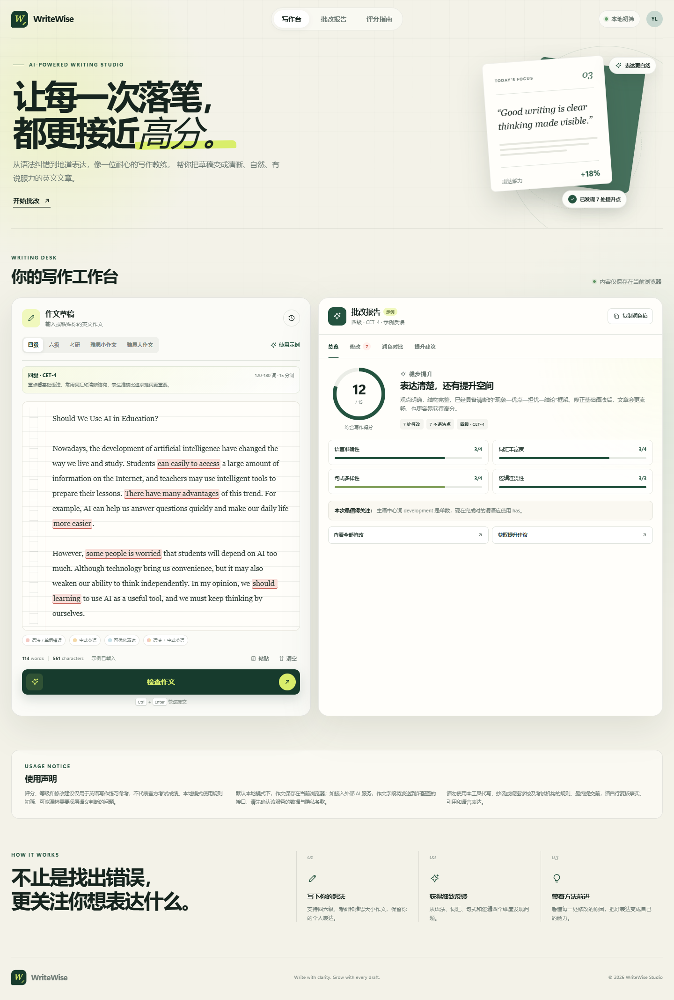

# WriteWise Essay Coach

一个面向四六级、考研英语和雅思写作的英语作文练习工具，包含可直接使用的响应式网页，以及可复用的 Codex Skill。

[在线体验](https://laishangen.github.io/writewise-essay-coach/) · [Codex Skill](.agents/skills/writewise-essay-coach) · [本地运行](#本地运行)



## 项目亮点

- 支持四级、六级、考研英语、IELTS Task 1 和 IELTS Task 2 五种独立写作标准。
- 不同模式拥有独立的字数范围、评分维度、修改优先级、结构建议和润色策略。
- 错误标注直接显示在可编辑作文中：红色表示语法/单词错误，橙色表示中式英语，蓝色表示标准优化项。
- 点击高亮内容可查看修改原因，并直接在原文中应用修改。
- 润色对比始终使用点击“检查作文”时保存的首版原文。
- 可自动生成针对当前文章的评分、修改建议和提升建议，不截断唯一的语法问题。
- 切换写作模式不会自动重新分析，必须由用户主动点击“检查作文”。

## 写作标准

| 模式 | 篇幅 | 评分 |
| --- | --- | --- |
| 四级 CET-4 | 120–180 词 | 15 分制 |
| 六级 CET-6 | 150–200 词 | 15 分制 |
| 考研英语大作文 | 160–200 词 | 20 分制 |
| IELTS Task 1 | 至少 150 词 | Band 1–9 |
| IELTS Task 2 | 至少 250 词 | Band 1–9 |

雅思两项任务均按四项标准评估：

- Task 1：任务完成度、连贯与衔接、词汇资源、语法范围与准确性。
- Task 2：任务回应、连贯与衔接、词汇资源、语法范围与准确性。

## 在线版本说明

在线网页默认使用浏览器本地规则初筛，不会调用 AI 后端，也不会消耗网站所有者的模型 Token。

本地规则不能完全替代模型对文章语义和上下文的深度理解。需要完整的 AI 逐句分析时，请使用仓库中的 Codex Skill。

## 使用 Codex Skill

Skill 位于：

```text
.agents/skills/writewise-essay-coach
```

在 Codex 中调用：

```text
$writewise-essay-coach
```

也可以把该目录复制到个人 Skills 目录：

```text
%USERPROFILE%\.agents\skills\
```

使用 Skill 时，模型调用消耗的是使用者自己的 Codex 账户或 API 额度。

## 本地运行

```powershell
python -m http.server 4173 --directory docs
```

打开：

```text
http://127.0.0.1:4173/
```

## 技术栈

- HTML5
- CSS3
- 原生 JavaScript
- Codex Skill
- GitHub Pages

## 仓库结构

```text
writewise-essay-coach/
├─ docs/                         # 静态网站与预览截图
├─ .agents/skills/
│  └─ writewise-essay-coach/     # Codex Skill
├─ README.md
└─ .gitignore
```

## 更新网站

网站由 `main` 分支的 `/docs` 目录发布。修改 `docs/` 后提交并推送：

```powershell
git add docs
git commit -m "Update website"
git push
```

GitHub Pages 会自动更新。

## 使用声明

- 评分和修改建议仅用于英语写作练习参考，不代表官方考试成绩。
- 在线静态版可能漏检需要深层语义判断的问题。
- 请勿将本工具用于代写、抄袭或规避学校及考试规则。
- 仓库中不包含 API Key；如未来接入外部 AI 服务，密钥必须保存在服务端环境变量中。
